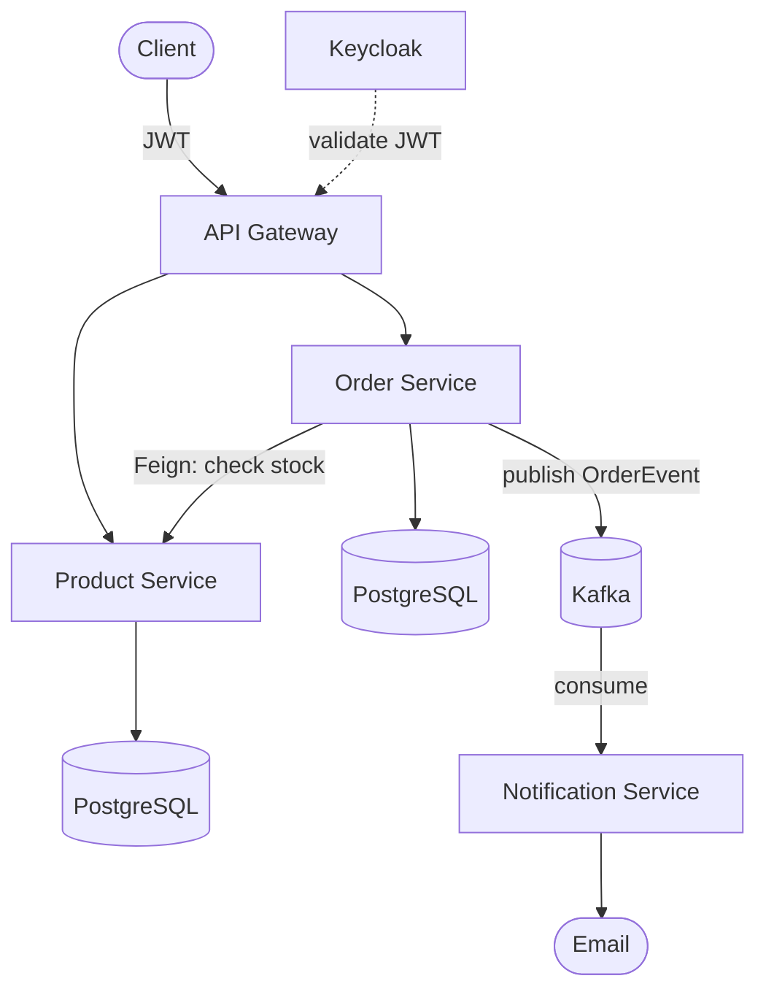
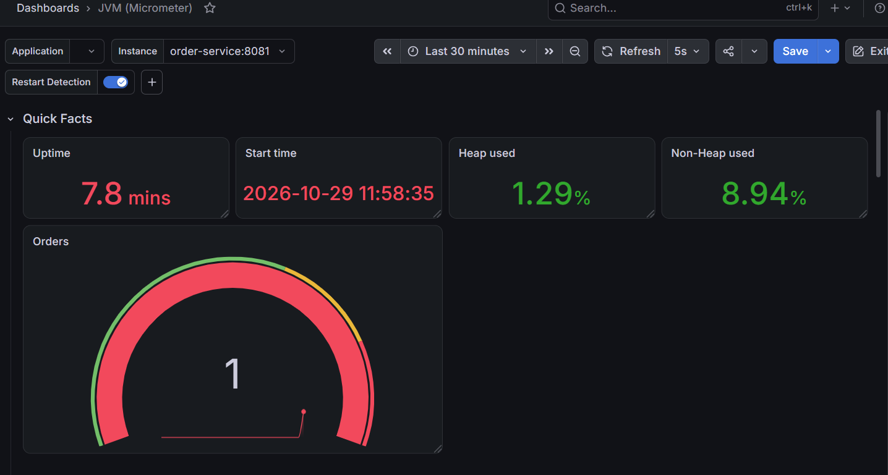

# E-commerce Microservices Platform


Pet-проект, демонстрирующий построение отказоустойчивой микросервисной архитектуры на Java 17 / Spring Boot 3 с event-driven взаимодействием, полным CI/CD и мониторингом.

## Архитектура

Проект состоит из следующих микросервисов:
- **gateway-service**: Точка входа (Spring Cloud Gateway), маршрутизация и валидация JWT (Keycloak).
- **product-service**: Управление каталогом товаров (PostgreSQL).
- **order-service**: Оформление заказов, проверка стоков (Feign) и публикация событий в Kafka.
- **notification-service**: Асинхронное потребление событий из Kafka и отправка email-уведомлений.
- **eureka-server**: Service Discovery.

Взаимодействие:
1. Клиент отправляет запрос через API Gateway (с JWT-токеном).
2. `order-service` синхронно проверяет наличие товара через `product-service` (OpenFeign).
3. При создании заказа `order-service` сохраняет его в БД и отправляет событие `OrderEvent` в Kafka.
4. `notification-service` читает событие и отправляет email.



## Стек технологий

- **Язык и фреймворки:** Java 17, Spring Boot 3, Spring Cloud (Gateway, Eureka, OpenFeign), Spring Security.
- **Базы данных:** PostgreSQL, Spring Data JPA, Hibernate, MapStruct.
- **Брокеры сообщений:** Apache Kafka (Spring Kafka), Caffeine Cache (для идемпотентности).
- **Безопасность:** Keycloak (OAuth2 Resource Server, JWT).
- **Тестирование:** JUnit 5, Mockito, Testcontainers (PostgreSQL, Kafka), Awaitility, JaCoCo.
- **Инфраструктура и DevOps:** Docker, Docker Compose, Kubernetes (Deployments, Services, Ingress, HPA), Helm (Bitnami PostgreSQL), GitHub Actions.
- **Мониторинг:** Spring Boot Actuator, Micrometer, Prometheus, Grafana, Alertmanager.

## Запуск проекта локально

Для запуска всей инфраструктуры (сервисы, БД, Kafka, Keycloak, Prometheus, Grafana) достаточно Docker Compose.

1. Клонируйте репозиторий:
```bash
git clone https://github.com/AndreiMinsk/ecommerce-microservices.git
cd ecommerce-microservices
```

2. Создайте файл `.env` в корне (для `notification-service`):
```env
MAIL_HOST=smtp.example.com
MAIL_PORT=587
MAIL_USERNAME=your_email@example.com
MAIL_PASSWORD=your_password
```

3. Запустите проект:
```bash
docker compose up -d --build
```

4. Доступные сервисы:
- **API Gateway:** `http://localhost:8083`
- **Keycloak (Admin):** `http://localhost:8180` (admin/admin)
- **Grafana:** `http://localhost:3000` (admin/admin)
- **Prometheus:** `http://localhost:9090`
- **Eureka Dashboard:** `http://localhost:8761`

## Деплой в Kubernetes (Helm)

В папке `helm/` находится чарт для развертывания проекта в кластере.

```bash
helm install ecommerce ./helm/ecommerce-chart -f ./helm/ecommerce-chart/values-dev.yaml
```

*Примечание: В чарте настроены liveness/readiness probes на базе Actuator, HPA для автоскейлинга `product-service` и зависимости PostgreSQL.*

## Мониторинг и Observability

- **Метрики:** Собираются через `Spring Boot Actuator` и `Micrometer`.
- **Бизнес-метрики:** Реализован кастомный счетчик заказов (`business_orders_total`), который выведен на дашборд в Grafana.
- **Алертинг:** Настроены правила в `alerts.yml` (деградация p95 latency, переполнение Heap). Проверено срабатывание через намеренный `OOMKill` (см. `oom-test.yaml`).



## CI/CD

В проекте настроены пайплайны на **GitHub Actions**:
- Запуск происходит только при изменениях в конкретном сервисе (path-фильтры).
- Выполняется сборка, прогон тестов и проверка покрытия (JaCoCo Line >= 80%, Branch >= 70%).
- Собираются multi-stage Docker-образы и пушатся в Docker Hub.
- При падении сборки отправляется уведомление на email.